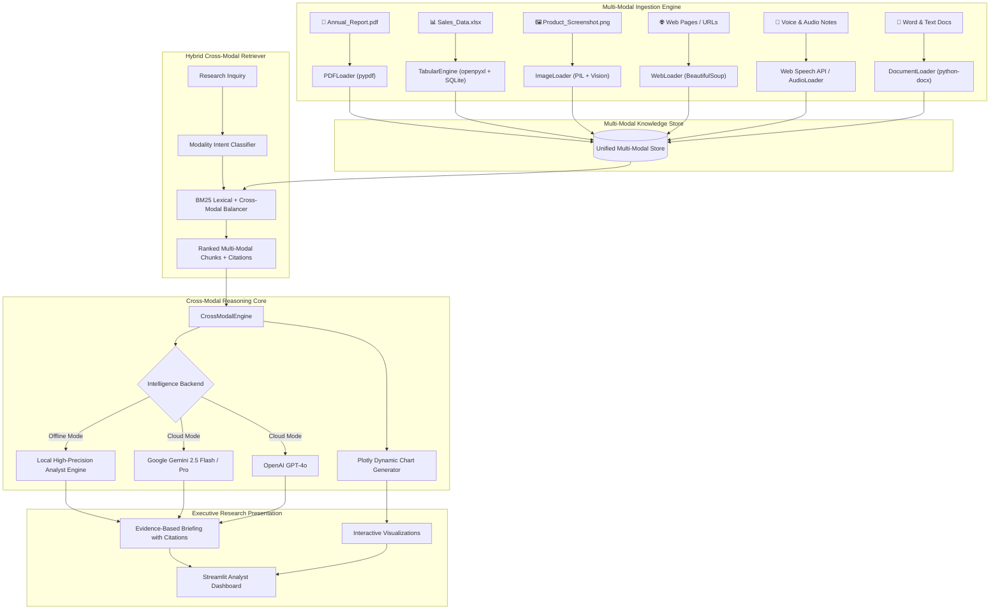

# 🏛️ Multi-Modal Enterprise Intelligence & Research Assistant

[](https://www.python.org/)
[](https://streamlit.io/)
[](https://ai.google.dev/)
[](https://openai.com/)
[](LICENSE)

An enterprise-grade, multi-modal Retrieval-Augmented Generation (RAG) and research analyst system. Unlike conventional text-only PDF chatbots, this system ingests, cross-references, queries, and reasons across **six heterogeneous enterprise modalities**:

1. 📄 **PDFs**: Annual reports, 10-K SEC filings, research papers, policies, and manuals with page-level citations.
2. 📊 **Excel & CSV**: Financial performance, sales records, employee logs with in-memory SQLite table registration, SQL query sandbox, and automated statistics.
3. 🖼️ **Images & Telemetry**: Operational dashboards, funnel charts, system error diagrams, and screenshots evaluated via Multi-Modal Vision.
4. 🌐 **Web Pages**: Live corporate links, competitor press releases, and industry publications scraped and indexed on the fly.
5. 🎤 **Voice Queries**: Natural verbal inquiries via real-time browser microphone speech recognition (HTML5 Web Speech API) or uploaded audio files (.wav, .mp3).
6. 📝 **Documents**: Executive memos, meeting notes, Word (.docx) documents, and Markdown.

---

## 🚀 The Enterprise Scenario (Built-In Demo)

The system comes pre-loaded with a **1-Click Enterprise Case Study** matching a real-world scenario:
- **`Annual_Report.pdf`**: 4-page corporate report & CEO letter from *AuraCorp Technologies* disclosing operational hiccups and EMEA regulatory friction.
- **`Sales_Data.xlsx`**: Multi-sheet quarterly performance dataset tracking revenues, gross profits, and regional sales contraction (-29.7% drop in Q3).
- **`Product_Screenshot.png`**: High-resolution telemetry alert showing a checkout funnel dropout spike (34.2%) during a payment gateway migration.
- **`Market_Research.pdf`**: 3-page industry intelligence report detailing Fortune 1000 IT budget freezes and aggressive competitor price discounting (HyperScale 18% cut).

### Research Inquiry:
> *"Why did our revenue decrease in Q3, and what are the major market factors responsible?"*

### Cross-Modal Resolution:
1. **Spreadsheet Analysis**: Queries SQLite table to compute exact quarterly variance: -$4.7M (-29.7%) drop from $15.8M (Q2) to $11.1M (Q3).
2. **Product Screenshot Telemetry**: Identifies the 34.2% checkout funnel dropout spike in August caused by the multi-currency payment gateway serialization bug blocking $1.9M in ARR.
3. **Annual Report Disclosures**: Extracts CEO disclosures regarding European DORA compliance delays pushing $1.4M in contract closings into Q4.
4. **Market Intelligence**: Uncovers macro IT spending freezes (42% of CTOs pausing expansions) and competitor HyperScale's 18% price slashing campaign.
5. **Dynamic Visualizations**: Automatically generates Plotly interactive charts:
   - Quarterly Revenue Trajectory with highlighted Q3 drop
   - Regional Revenue Contraction (North America, EMEA, APAC, LATAM)
   - Revenue Variance Waterfall Chart (visualizing internal vs. external drivers)

---

## 🏗️ System Architecture



---

## 🛠️ Installation & Setup

### 1. Prerequisites
- Python 3.10, 3.11, or 3.12
- Windows, macOS, or Linux

### 2. Workspace Setup
Navigate to the project directory:
```powershell
cd C:\Users\yugal\.gemini\antigravity\scratch\multimodal-enterprise-assistant
```

### 3. Install Dependencies
```bash
pip install -r requirements.txt
```

### 4. Run the Application
Launch the Streamlit interactive dashboard:
```bash
streamlit run app.py
```
*Or via python module:*
```bash
python -m streamlit run app.py
```
Open your browser at `http://localhost:8501`.

---

## 🔑 AI Reasoning Engine Configuration

The assistant offers three flexible intelligence backends:

1. **⚡ Local High-Precision Engine (Default - 0 API Key Required)**:
   - Works immediately out of the box with zero setup.
   - Deterministic SQL table querying, cross-modal evidence synthesis, and strict citations ledger.
2. **♊ Google Gemini (Gemini 2.5 Flash / Gemini 1.5 Pro)**:
   - Native multimodal comprehension across high-res images, text, and documents.
   - Enter your `GEMINI_API_KEY` in the sidebar or set `GEMINI_API_KEY` in `.env`.
3. **🤖 OpenAI (GPT-4o / GPT-4o-mini)**:
   - Vision and text cross-reasoning.
   - Enter your `OPENAI_API_KEY` in the sidebar or set `OPENAI_API_KEY` in `.env`.

---

## 📁 Project Directory Structure

```
multimodal-enterprise-assistant/
├── app.py                      # Main Streamlit Web Application
├── config.py                   # App configuration, constants, model options
├── requirements.txt            # Python dependencies
├── test_pipeline.py            # Automated end-to-end pipeline verification test
├── README.md                   # Complete architectural and usage guide
│
├── core/
│   ├── ingestion/              # Multi-Modal Document Loaders
│   │   ├── pdf_loader.py       # PDF parser with page index and chunking
│   │   ├── tabular_loader.py   # Excel/CSV parser, column stats & SQLite engine
│   │   ├── image_loader.py     # Image metadata, base64 payload & vision analyzer
│   │   ├── web_loader.py       # Live URL scraper & HTML content cleaner
│   │   ├── doc_loader.py       # Word (.docx) & plain text parser
│   │   └── audio_loader.py     # Audio note processor & transcription handler
│   │
│   ├── rag/                    # Multi-Modal Knowledge Store & Retriever
│   │   ├── store.py            # Unified in-memory multi-modal repository
│   │   ├── retriever.py        # BM25 + intent-aware cross-modal hybrid ranking
│   │   └── cross_modal_engine.py # Central orchestrator & citation synthesizer
│   │
│   ├── visualization/          # Interactive Chart Generation
│   │   └── chart_generator.py  # Plotly enterprise bar, waterfall & trend charts
│   │
│   └── llm/                    # Intelligence Clients
│       ├── gemini_client.py    # Google Gemini 2.5 Flash / Pro (google-genai SDK)
│       ├── openai_client.py    # OpenAI GPT-4o client
│       └── mock_engine.py      # Local high-fidelity deterministic analyst engine
│
├── sample_data/                # Complete enterprise case study files
│   ├── Annual_Report.pdf       # 4-page corporate report & financial filing
│   ├── Sales_Data.xlsx         # 3-sheet quarterly revenue & regional dataset
│   ├── Product_Screenshot.png  # Telemetry alert showing 34.2% checkout dropout
│   ├── Market_Research.pdf     # 3-page macro research on IT spend & price wars
│   └── create_sample_data.py   # Programmatic generator for the sample files
│
└── static/
    └── voice_input.html        # HTML5 Web Speech API browser microphone component
```

---

## 🧪 Testing

Run the automated verification suite:
```bash
python test_pipeline.py
```
This tests:
- PDF page extraction and citation indexing
- Excel parsing into in-memory SQLite tables with verified SQL queries
- Image loading and base64 vision preparation
- Hybrid retrieval with cross-modality diversification
- Analytical reasoning and Plotly chart generation

---

## 📄 License
MIT License. Built for enterprise multi-modal intelligence and research workflows.
